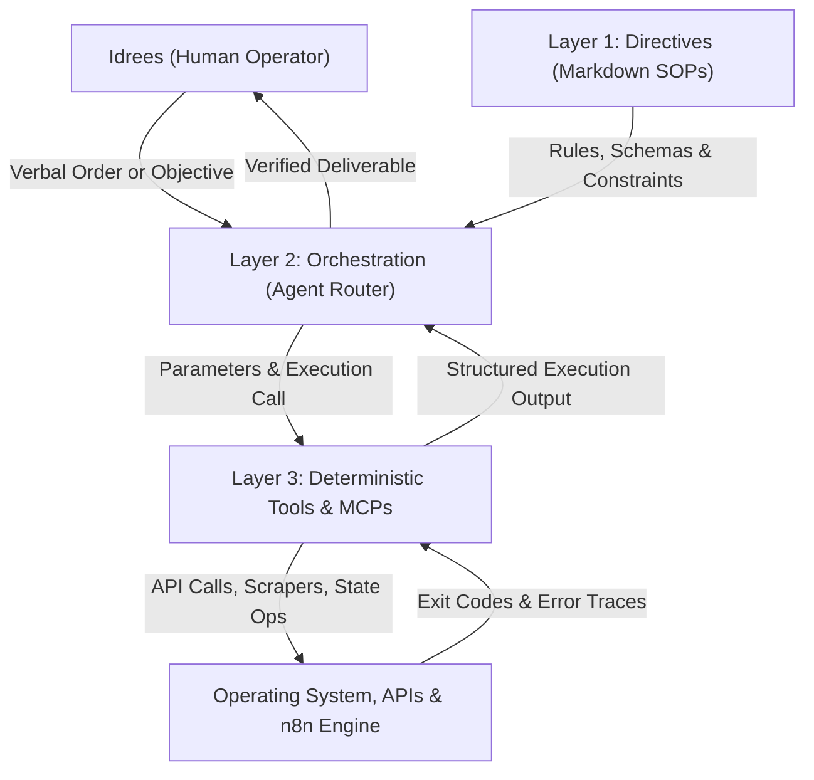

# Autonomous Agentic Workflows & Multi Agent Infrastructure Suite

A production grade autonomous agent framework, custom Model Context Protocol (MCP) server suite, and library of 80+ enterprise n8n workflow blueprints. Designed for high velocity automation, deterministic script execution, and self healing recovery.

Architected and maintained by **Idrees Qurashi**.

---

## 1. System Architecture: The Deterministic 3 Layer Framework

Single turn LLMs and naive autonomous loops fail predictably in production. When an agent attempts to reason, plan, parse APIs, and manipulate databases within a single prompt loop, errors compound geometrically.

This repository implements a deterministic 3 layer architecture that separates concerns completely:
* **Layer 1: Directives (What to do):** Natural language standard operating procedures in `directives/` defining operational scope, schemas, tool constraints, and failure protocols.
* **Layer 2: Orchestration (Decision making):** The reasoning agent acting strictly as an intelligent router. It inspects directives, constructs parameter schemas, invokes deterministic tools, and handles recovery.
* **Layer 3: Execution (Doing the work):** Zero hallucination, deterministic Python scripts in `execution/` handling network calls, file system operations, and database state transitions.



---

## 2. Core Components

### A. Enterprise n8n Workflows Library (`n8n_workflows/`)
Over 80 production grade, sanitized n8n workflow JSON blueprints organized across 9 operational domains:
* `01_ai_agents_and_swarms/`: Interactive multi agent swarms, tool accuracy evaluators, Jarvis productivity agent, multi agent clinic management, and design agency simulations.
* `02_b2b_lead_engines_and_scraping/`: Autonomous B2B lead enrichment engines, Google Maps scrapers with Apify, Firecrawl web browsing agents, and lead scoring pipelines.
* `03_rag_and_knowledge_systems/`: Retrieval Augmented Generation systems across Qdrant, Pinecone, Supabase, Mistral OCR, MongoDB vector embeddings, and local Ollama PGVector setups.
* `04_content_and_autoposting/`: Multi platform social publishers, SEO blog generators with WordPress, arXiv AI trend alerters, and video creation workflows with VEO 3.
* `05_messaging_and_voice_ai/`: AI WhatsApp chatbots with voice/PDF support, ElevenLabs voice agents, Twilio phone receptionists, and Telegram assistants.
* `06_production_health_and_monitoring/`: Global error handlers, instance health monitors, PostgreSQL logging with rate limited alerts, and smart failure recovery.
* `07_document_and_cv_intelligence/`: AI resume screening with GPT 4o, candidate scoring flows with Gemini, and large document OCR.
* `08_financial_and_market_intelligence/`: Automated daily financial analysis from Loyverse POS, inventory forecasting, and competitor pricing monitors with Bright Data.
* `09_enterprise_blueprints_and_utilities/`: Core routing shells, webhook bridges, and CRM synchronization nodes.

### B. Custom Model Context Protocol (MCP) Server Suite (`mcp_servers/`)
Lightweight, native Python MCP servers providing tools for local system automation, research, and communication:
* `claude_code_mcp.py`: Autonomous task execution, session control, proxy routing, and architecture knowledge retrieval.
* `live_search_mcp.py`: Real time web search and news monitoring tools.
* `pc_master_mcp.py`: Secure file reading, writing, searching, and system health telemetry.
* `notifier_mcp.py`: Telegram notifications, desktop alerts, and webhook triggers.
* `memory_graph_mcp.py`: Long term memory graph storage, entity linking, and fact retrieval.
* `gmail_engine_mcp.py`: Email auditing, inbox filtering, and bespoke email dispatching.
* `github_mcp.py`: Repository discovery, file inspections, and issue automation.
* `lead_engine_mcp.py`: Job database queries, MX email verification, and Ashby/Greenhouse/Lever scraping.
* `daily_agenda_mcp.py`: Local calendar scheduling and event tracking.

### C. Claude Code Autonomous Scripts (`claude_code/`)
High velocity CLI automation scripts engineered for geographic data mining, spatial queries, and multi source extraction:
* OpenStreetMap Overpass API spatial miners (`query_osm.py`, `query_osm_area.py`, `query_osm_wider.py`)
* Nominatim geocoding and reverse lookup tools (`search_nominatim.py`, `search_nominatim_2.py`)
* Resilient DuckDuckGo intelligence extraction (`search_ddg.py`, `search_ddg_2.py`)
* Yelp directory extraction and parsing engines (`fetch_yelp.py`)

### D. Antigravity Agent Skills (`.agents/skills/`)
Specialized agent skills equipping autonomous coding assistants with deterministic protocols:
* `b2b_lead_engine`: Med spa, aesthetics, and cosmetic dental lead extraction with Gemini ICP qualification.
* `epaper_autopublisher`: Automated e paper ingestion, DearFlip post generation, and daily WordPress publishing.
* `job_hunter`: The Holy 30 Pipeline, 11/10 qualification rubrics, Zero Bounce OS, and ATS standards.
* `context_optimizer`: Token economy governance, context hygiene, and progressive disclosure.
* `core_engineering`: Local infrastructure orchestration for n8n, Gemini pools, and proxy routing.
* `mak_copilot`: 2 hour daily operational shift execution, step evidence logs, and Loom briefs.
* `self_annealer`: Automated failure capture, minimal reproducer generation, tool patching, and directive updates.
* `shadow_harness`: Cognitive auditing, error recovery, and complex system troubleshooting.
* `spec_driven_dev`: Specification drafting, ambiguity resolution, and atomic task decomposition.
* `tdd_engine`: Test Driven Development enforcement with 80%+ coverage requirements.

### E. Execution Layer (`execution/`)
Production Python scripts handling deterministic pipeline steps:
* `outbound/`: Headless Playwright scrapers, Gemini ICP qualification, and verified email dispatchers.
* `epaper_autopublisher/`: Newspaper batch scrapers and DearFlip WordPress uploaders.
* `apply_hardened_workflow.py` & `deploy_n8n_workflow.py`: Automated n8n API configuration and deployment tools.

---

## 3. Repository Structure

```
agentic-workflows/
├── .agents/skills/                    # Specialized agent capability skills
│   ├── b2b_lead_engine/
│   ├── context_optimizer/
│   ├── core_engineering/
│   ├── epaper_autopublisher/
│   ├── job_hunter/
│   ├── mak_copilot/
│   ├── personal_brand/
│   ├── self_annealer/
│   └── tdd_engine/
│
├── directives/                        # Layer 1: Operational SOPs and specs
│   ├── master_operating_directive.md
│   ├── autonomous_outbound_pipeline.md
│   ├── b2b_lead_scraping.md
│   ├── n8n_health_monitor_spec.md
│   └── sop_n8n_health_monitor.md
│
├── orchestration/                     # Layer 2: Decision routing and controllers
│   └── b2b_lead_pipeline.py
│
├── execution/                         # Layer 3: Deterministic Python execution
│   ├── outbound/                      # Lead scraping and ICP evaluation
│   ├── epaper_autopublisher/          # Automated publishing engine
│   ├── deploy_n8n_workflow.py         # n8n deployment automation
│   └── create_health_monitor.py       # Health monitor deployer
│
├── mcp_servers/                       # Custom Model Context Protocol server suite
│   ├── claude_code_mcp.py
│   ├── live_search_mcp.py
│   ├── pc_master_mcp.py
│   ├── notifier_mcp.py
│   ├── memory_graph_mcp.py
│   ├── gmail_engine_mcp.py
│   └── github_mcp.py
│
├── claude_code/                       # Autonomous CLI extraction and spatial miners
│   ├── fetch_yelp.py
│   ├── query_osm.py
│   └── search_nominatim.py
│
├── n8n_workflows/                     # 80+ Enterprise n8n workflow blueprints
│   ├── manifest.json                  # Complete machine readable workflow catalog
│   ├── 01_ai_agents_and_swarms/
│   ├── 02_b2b_lead_engines_and_scraping/
│   ├── 03_rag_and_knowledge_systems/
│   ├── 04_content_and_autoposting/
│   ├── 05_messaging_and_voice_ai/
│   ├── 06_production_health_and_monitoring/
│   ├── 07_document_and_cv_intelligence/
│   ├── 08_financial_and_market_intelligence/
│   └── 09_enterprise_blueprints_and_utilities/
│
├── blueprints/                        # Standalone JSON automation blueprints
│   ├── make_whatsapp_conversational_bot.json
│   ├── workflow_1_nick_saraev.json
│   └── workflow_4_enterprise_swarm.json
│
├── LICENSE                            # MIT Open Source License
└── README.md
```

---

## 4. Getting Started

### Prerequisites
* Linux environment (Ubuntu 22.04+ or Debian recommended)
* Python 3.10+
* Docker & Docker Compose (for running local n8n workflows)

### Installation
```bash
git clone https://github.com/IdreesQurashi/agentic-workflows.git
cd agentic-workflows
python3 -m venv .venv
source .venv/bin/activate
pip install -r requirements.txt
```

### Running MCP Servers
To connect an MCP server (such as `live_search_mcp.py` or `claude_code_mcp.py`) to your AI client, add it to your client's MCP configuration:
```json
{
  "mcpServers": {
    "live_search": {
      "command": "python3",
      "args": ["/path/to/agentic-workflows/mcp_servers/live_search_mcp.py"]
    }
  }
}
```

### Importing n8n Blueprints
All workflows in `n8n_workflows/` can be imported directly into any n8n instance via:
1. Navigating to your n8n canvas.
2. Clicking the workflow menu (three dots) and selecting **Import from File**.
3. Selecting any desired `.json` blueprint from the categorized directories.

---

## 5. License & Author

Open source under the **MIT License**.

Architected, coded, and maintained by **Idrees Qurashi**.
* GitHub: [https://github.com/IdreesQurashi](https://github.com/IdreesQurashi)
* Portfolio: [https://idreesqurashi.github.io](https://idreesqurashi.github.io)
