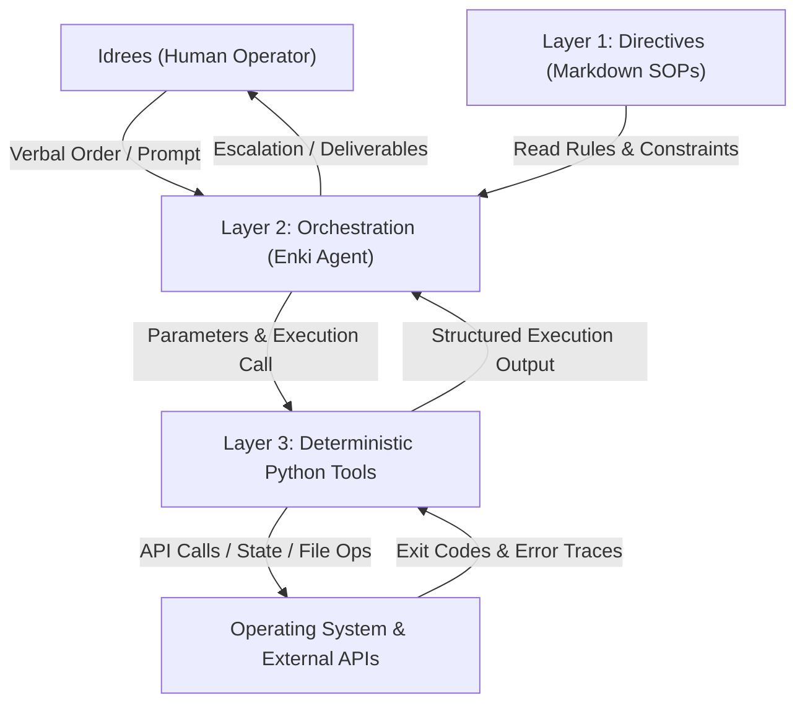

# Deterministic 3 Layer Autonomous Agent Engine

A production grade autonomous agent framework designed for high velocity enterprise workflows, deterministic script execution, and continuous self annealing on Linux environments.

Architected and maintained by **Idrees Qurashi**.

---

## 1. Executive Overview

Single turn LLMs and naive autonomous loops fail predictably in production. When an agent attempts to reason, plan, parse APIs, and manipulate databases within a single prompt loop, errors compound geometrically. Over 5 sequential actions, a 90% per step accuracy drops to an overall 59% reliability rate.

This repository implements a deterministic 3 layer architecture that separates concerns completely:
* **Layer 1: Directive (What to do):** Natural language standard operating procedures in `directives/` defining scope, inputs, outputs, tool constraints, and failure protocols.
* **Layer 2: Orchestration (Decision making):** The reasoning agent (Enki) acting strictly as an intelligent router. It inspects directives, constructs parameter schemas, invokes deterministic tools, and handles recovery.
* **Layer 3: Execution (Doing the work):** Zero hallucination, deterministic Python scripts in `execution/` handling network calls, file system operations, and database state transitions.



---

## 2. Core Execution Invariants (The Enki Kernel)

Every agent and subagent operating inside this engine is hard bound to the Enki Kernel:

* **Relentless Quality Mandate:** 100% effort to achieve 100% quality on every turn. Zero placeholder code, zero TODO comments, zero half baked solutions. Deliverables must be production grade on the first pass.
* **40000x Velocity Driver:** Relentless execution speed. Zero sluggish hesitation, zero dragging of feet, zero unnecessary turn splitting.
* **Universal Brutal Honesty:** Sycophancy is banned. When the operator holds a flawed assumption, makes a logic error, or misjudges an architectural priority, the agent calls it out neutrally and immediately with the correct technical fix.
* **Read Before Write Invariant:** Full inspection of exact file contents and line numbers before proposing or writing any diff. Zero blind guessing.
* **Two Strike Task Breaker:** If any script, tool call, or shell execution fails on two consecutive attempts, the agent halts that specific task immediately and surfaces the root cause for human decision before any retry.
* **Deterministic Script Separation:** Push ambiguity resolution and natural language reasoning to the LLM. Route all API calls, file writes, and data pipelines to deterministic Python scripts.
* **Strict Verbal Order Gate:** Never execute modifying commands, write production files, or trigger external actions without explicit verbal approval from the human operator.

---

## 3. Key Engine Components

### A. Distributed Retry Engine (`execution/_retry.py`)
Implements exponential backoff with full decorrelated jitter to gracefully survive 429 rate limits, socket timeouts, and network drops across high throughput API loops.

### B. High Velocity Operations Copilot (`execution/automation/mak_session.py`)
Specialized real time operational tracker for 2 hour client execution shifts:
* Automated ISO timestamp step evidence logging.
* Banned corporate jargon and filler phrase scrubbing.
* Automatic export of plan first notes and daily client reports to local persistent storage.

### C. Master Operating Directives (`directives/master_operating_directive.md`)
The single source of truth defining:
* The 18 Operational Laws of Autonomous Systems (Karpathy boundaries, checkpoint persistence, self annealing loops).
* The 4 whitelisted enterprise roles (AI Automation, Agentic Systems, Prompt Engineering, n8n Specialization).
* Zero Bounce OS deliverability filters with 900 to 1800 second randomized send pacing.

---

## 4. Repository Structure

```
├── .agents/                   # Custom agent definitions and persistent skills
│   └── skills/                # Domain specific skills (mak_copilot, tdd_engine, etc.)
├── AGENTS.md                  # Master agent execution instructions and kernel laws
├── directives/                # Layer 1 SOPs and governance directives
│   ├── master_operating_directive.md
│   └── workflows/
├── execution/                 # Layer 3 deterministic Python scripts
│   ├── _retry.py              # Exponential backoff retry engine
│   └── automation/            # Operational scripts and session monitors
├── harness/                   # Cognitive auditing harnesses and eval loops
├── CLAUDE.md                  # Mirrored instruction kernel
├── GEMINI.md                  # Mirrored instruction kernel
├── requirements.txt           # Python dependencies
└── .gitignore                 # Airtight secret and data protection
```

---

## 5. Getting Started

### Prerequisites
* Linux environment (Ubuntu / Debian recommended)
* Python 3.10+
* Virtual environment configured

### Installation
```bash
git clone https://github.com/IdreesQurashi/agentic-workflows.git
cd agentic-workflows
python3 -m venv .venv
source .venv/bin/activate
pip install -r requirements.txt
```

---

## 6. Engineering Standard & Author

Designed and implemented by **Idrees Qurashi** as a production framework for resilient autonomous systems.
