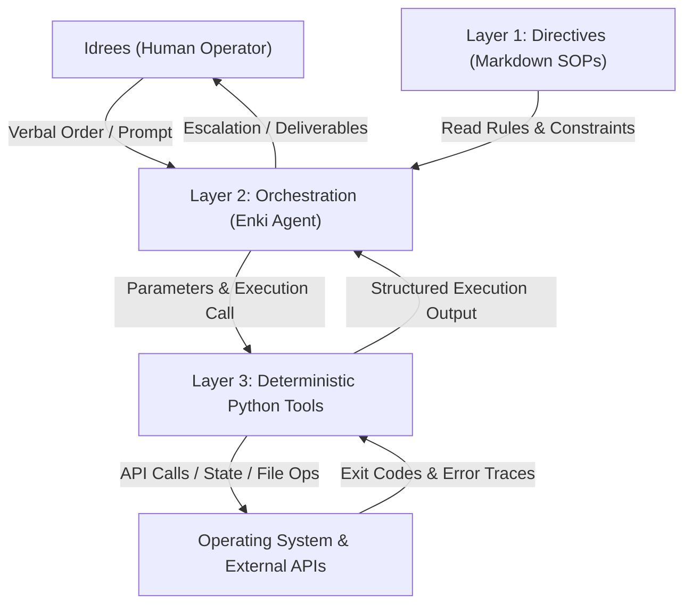

# Deterministic 3 Layer Autonomous Agent Engine

A production grade autonomous agent framework designed for high velocity enterprise workflows, deterministic script execution, and continuous self annealing on Linux environments.

Architected and maintained by **Idrees Qurashi**.

---

## 1. Executive Overview

Single turn LLMs and naive autonomous loops fail predictably in production. When an agent attempts to reason, plan, parse APIs, and manipulate databases within a single prompt loop, errors compound geometrically. Over 5 sequential actions, a 90% per step accuracy drops to an overall 59% reliability rate.

This repository implements a deterministic 3 layer architecture that separates concerns completely:
* **Layer 1: Directive (What to do):** Natural language standard operating procedures in `directives/` defining scope, inputs, outputs, tool constraints, and failure protocols.
* **Layer 2: Orchestration (Decision making):** The reasoning agent (Enki) acting strictly as an intelligent router. It inspects directives, constructs parameter schemas, invokes deterministic tools, and handles recovery.
* **Layer 3: Execution (Doing the work):** Zero hallucination, deterministic Python scripts in `execution/` handling network calls, file system operations, and database state transitions.



---

## 2. Core Execution Invariants (The Enki Kernel)

Every agent and subagent operating inside this engine is hard bound to the Enki Kernel:

* **Relentless Quality Mandate:** 100% effort to achieve 100% quality on every turn. Zero placeholder code, zero TODO comments, zero half baked solutions. Deliverables must be production grade on the first pass.
* **40000x Velocity Driver:** Relentless execution speed. Zero sluggish hesitation, zero dragging of feet, zero unnecessary turn splitting.
* **Universal Brutal Honesty:** Sycophancy is banned. When the operator holds a flawed assumption, makes a logic error, or misjudges an architectural priority, the agent calls it out neutrally and immediately with the correct technical fix.
* **Read Before Write Invariant:** Full inspection of exact file contents and line numbers before proposing or writing any diff. Zero blind guessing.
* **Two Strike Task Breaker:** If any script, tool call, or shell execution fails on two consecutive attempts, the agent halts that specific task immediately and surfaces the root cause for human decision before any retry.
* **Deterministic Script Separation:** Push ambiguity resolution and natural language reasoning to the LLM. Route all API calls, file writes, and data pipelines to deterministic Python scripts.
* **Strict Verbal Order Gate:** Never execute modifying commands, write production files, or trigger external actions without explicit verbal approval from the human operator.

---

## 3. Key Engine Components

### A. Layer 1: Directives (`directives/`)
Natural language SOPs defining constraints, schemas, and operational boundaries:
* `master_operating_directive.md`: 18 Operational Laws of Autonomous Systems, Karpathy boundaries, and role governance.
* `autonomous_outbound_pipeline.md`: Zero Bounce OS protocol, DNS MX verification, and randomized pacing rules.
* `high_velocity_copilot.md`: 2 hour client operational shift SOP, ISO step evidence, and 11:55 AM hard stop triggers.
* `runtime_eval_gating.md`: Evaluation Driven Development (EDD) rubric and 85% confidence floor specifications.
* `n8n_enterprise_vault.md`: n8n webhook synchronizations, vector database RAG nodes, and error handling.

### B. Layer 2: Orchestration (`orchestration/`)
The cognitive decision making, routing, and safety evaluation engine:
* `agent_kernel.py`: Enki Kernel runtime managing directive loading, state machines, and Two Strike Task Breaker governance.
* `workflow_router.py`: Multi agent router mapping natural language intents to specific execution pipelines.
* `eval_judge.py`: Runtime LLM as a Judge evaluator enforcing composite score floors before external action.
* `token_optimizer.py`: Token economy manager offloading bulk evaluation tasks to external Gemini worker pools.

### C. Layer 3: Execution (`execution/`)
Deterministic Python tools executing operations with zero hallucination risk:
* `core/retry_engine.py`: Base 2 exponential backoff retry engine with decorrelated jitter.
* `copilot/mak_session.py`: Automated ISO timestamp logger, corporate jargon scrubber, and client report exporter.
* `outbound/zero_bounce_dispatcher.py`: Paced daemon enforcing randomized 900 to 1800 second gaps and deduplication.
* `evals/runtime_eval_gater.py`: Structured Pydantic evaluation models and confidence score gating.
* `integrations/n8n_client.py`: API and webhook dispatcher for n8n workflow management.

---

## 4. Repository Structure

```
agentic-workflows/
├── directives/                        # Layer 1: The Instruction Set (Markdown SOPs)
│   ├── master_operating_directive.md
│   ├── autonomous_outbound_pipeline.md
│   ├── high_velocity_copilot.md
│   ├── runtime_eval_gating.md
│   └── n8n_enterprise_vault.md
│
├── orchestration/                     # Layer 2: Decision, Routing & Evaluation Engine
│   ├── __init__.py
│   ├── agent_kernel.py
│   ├── workflow_router.py
│   ├── eval_judge.py
│   └── token_optimizer.py
│
├── execution/                         # Layer 3: Deterministic Execution Tools
│   ├── __init__.py
│   ├── core/
│   │   └── retry_engine.py
│   ├── copilot/
│   │   └── mak_session.py
│   ├── outbound/
│   │   └── zero_bounce_dispatcher.py
│   ├── evals/
│   │   └── runtime_eval_gater.py
│   └── integrations/
│       └── n8n_client.py
│
├── harness/                           # Cognitive auditing and self annealing harness
│   ├── crash_capture.py
│   ├── patch_validator.py
│   └── executor.py
│
├── AGENTS.md                          # Master agent execution instructions
├── CLAUDE.md                          # Mirrored instruction kernel
├── GEMINI.md                          # Mirrored instruction kernel
├── requirements.txt                   # Production dependencies
└── .gitignore                         # Credentials and data isolation
```

---

## 5. Getting Started

### Prerequisites
* Linux environment (Ubuntu / Debian recommended)
* Python 3.10+
* Virtual environment configured

### Installation
```bash
git clone https://github.com/IdreesQurashi/agentic-workflows.git
cd agentic-workflows
python3 -m venv .venv
source .venv/bin/activate
pip install -r requirements.txt
```

---

## 6. Engineering Standard & Author

Designed and implemented by **Idrees Qurashi** as a production framework for resilient autonomous systems.
