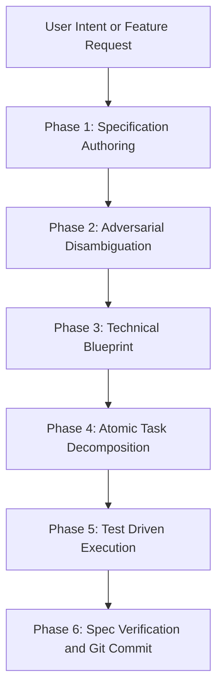

# Directive: Spec Driven Development Workflow

## 1. Executive Summary
Spec Driven Development is the foundational methodology separating professional Agentic AI engineers from undisciplined vibe coders. In this workflow, the formal written specification serves as the permanent source of truth and behavioral contract. The AI agent never writes implementation code until the intent, architectural boundaries, edge cases, and acceptance tests are codified and verified.

---

## 2. When to Activate This Workflow
* Developing new features, APIs, or data models from scratch.
* Refactoring legacy modules or altering core system architecture.
* Executing ambiguous, high value business requirements where misalignment risks token waste.
* Managing complex multi file modifications across multiple components.

---

## 3. The Five Phases of Spec Driven Development

### Phase 1: Specification Authoring (`spec.md`)
The engineer or agent drafts a clean specification document containing:
* Core Problem Statement: What business or technical bottleneck is being eliminated.
* Target Personas and User Journeys: Explicit roles and journeys using the format: As a role, I want action, so that benefit.
* Behavioral Invariants: Non negotiable system rules, guarantees, and constraints.
* Hard Acceptance Criteria: Observable, binary pass or fail criteria.

### Phase 2: Adversarial Disambiguation
Before proceeding to technical architecture, the agent conducts an adversarial audit of the specification:
* Identify Hidden Assumptions: Find implicit environmental, data, or timing assumptions.
* Edge Case Probing: What happens when network drops, inputs are empty, quotas are exceeded, or concurrent writes occur?
* Boundary Clarification: Explicitly declare what is out of scope to avoid scope creep.

### Phase 3: Technical Blueprint (`plan.md`)
Translate validated requirements into an architectural blueprint:
* Component Topology: File hierarchy, interfaces, and dependencies.
* Data Models and Schemas: Strict typings, validation rules, and persistence formats.
* Deterministic Tool Binding: Map each operation to specific Python execution scripts or MCP tools.
* Security and Trust Boundaries: Secret handling, input sanitization, and permission controls.

### Phase 4: Atomic Task Decomposition (`tasks.md`)
Decompose the technical blueprint into independent, testable, atomic milestones:
* Each task represents a single logical unit of work.
* Tasks are ordered by dependency graph (dependencies first).
* Each task explicitly declares its test target and verification command.

### Phase 5: Gated Execution and Verification
Execute tasks sequentially under strict gates:
* Write failing test asserting the task requirement (RED).
* Implement minimal code to satisfy the test (GREEN).
* Refactor for performance and clarity (REFACTOR).
* Verify completed feature against all original Phase 1 acceptance criteria.

---

## 4. Artifact Contracts and File Conventions

| Artifact | Standard Path | Purpose |
| :--- | :--- | :--- |
| Specification | `docs/specs/<feature>.spec.md` | Formal intent, business rules, acceptance criteria |
| Technical Plan | `docs/plans/<feature>.plan.md` | Architecture, data flow, component interfaces |
| Task Matrix | `docs/tasks/<feature>.tasks.md` | Atomic checklist with status tracking |

---

## 5. Failure Modes and Recovery Rules
* Scope Creep: If implementation reveals unexpected complexity, halt execution immediately. Return to Phase 1, update the specification, and obtain review before touching code.
* Spec Drift: Never bend the specification to match faulty implementation code. If code fails the spec, the code is incorrect until the spec is explicitly revised.
* Hallucinated Dependencies: Validate all package imports and APIs against local environment before finalizing the blueprint.
