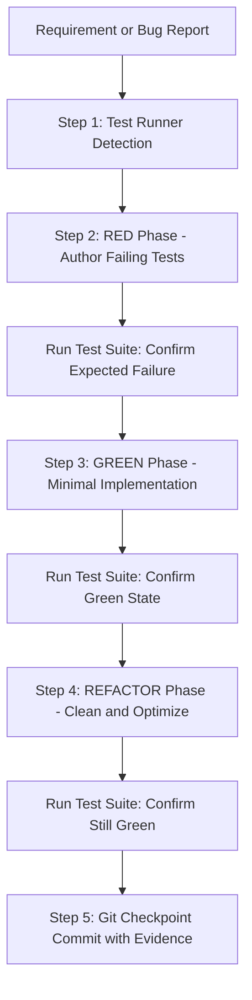

# Directive: Test Driven Development and Verification Engine

## 1. Executive Summary
The Test Driven Development and Verification Engine enforces that no production code or script modification is accepted without prior test coverage and verified execution. Autonomous agents left unconstrained tend to generate untested code that suffers from silent regressions. This workflow mandates the strict Red Green Refactor cycle, requiring verifiable proof of failure followed by verifiable proof of passing execution.

---

## 2. Core Operational Principles

### Principle 1: Tests Precede Implementation
Never write or alter application logic before a corresponding test exists. The test defines the contract. Code written without a failing test lacks empirical proof that it solves the underlying issue.

### Principle 2: Strict 80% Plus Coverage Target
All newly created or modified functions must achieve at least 80% test coverage across:
* Unit Tests: Pure functions, data parsers, utilities, and isolated component logic.
* Integration Tests: API contracts, database operations, and external network interactions.
* End to End Tests: Complete user journeys, CLI commands, and automated Playwright workflows.

### Principle 3: Binary Verification Evidence
An agent must never report a task as complete based on assumption. Completion requires capturing and validating the exit code 0 and runner telemetry from the execution environment.

---

## 3. Step by Step Runbook

### Step 1: Detect and Configure the Test Runner
Before running commands, detect the project test runner rather than making blind assumptions:
* Python projects: Detect `pytest` or `unittest` inside the virtual environment (`.venv/bin/pytest`).
* JavaScript or TypeScript: Inspect `package.json` for Jest, Vitest, or Bun native test runner (`bun test`).
* Execution scripts: Use standalone test fixtures or test runners (e.g. `test_runner_fixtures.py`).

### Step 2: The RED Phase (Author Failing Tests)
1. Formulate test cases capturing expected behavior, edge cases, and known failure modes:
   * Boundary inputs (empty strings, zero, maximum size payloads).
   * Network timeouts, rate limits, and server error responses.
   * Malformed data structures and missing fields.
2. Run the test suite:
   * The test MUST fail.
   * Verify that it fails for the expected reason, not due to an environmental syntax error.
   * Record the failure log as RED evidence.

### Step 3: The GREEN Phase (Minimal Implementation)
1. Write the minimal amount of code necessary to make the failing test pass.
2. Avoid premature optimization, extra speculative features, or over engineering.
3. Run the test suite:
   * Confirm that all tests now pass cleanly with exit code 0.
   * Record the passing log as GREEN evidence.

### Step 4: The REFACTOR Phase (Clean and Harden)
1. Review the passing code for clarity, modularity, and algorithmic efficiency.
2. Remove duplicated logic, dead variables, and confusing naming.
3. Rerun the test suite after each micro edit to verify that green status remains completely intact.

### Step 5: Git Checkpointing and Evidence Logging
When working within a version controlled repository, create atomic checkpoint commits:
* Commit 1: RED test created with failure evidence recorded.
* Commit 2: GREEN minimal implementation passing suite.
* Commit 3 (Optional): Refactor and optimization completed.

---

## 4. Edge Cases and Safeguards
* Flaky Tests: Any test exhibiting intermittent failures must be quarantined and investigated for race conditions, uncontrolled asynchronous operations, or shared global state.
* Mock Leaks: Ensure all external mocks and API stubs are reset after each test execution to prevent test pollution.
* Silent Test Skips: Never mark tests as skipped or disabled to mask a broken implementation. Every test in the active suite must execute and pass.
