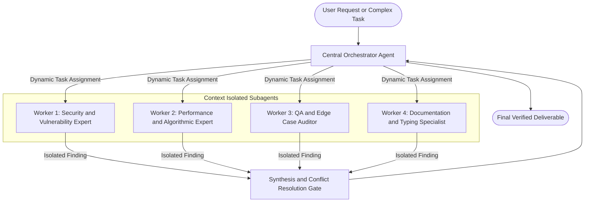

# Directive: Orchestrator Workers Multi Agent Pattern

## 1. Executive Summary
The Orchestrator Workers Pattern is the industry standard architectural model for complex, high dimensional tasks where the complete set of required subtasks cannot be predicted in advance. A central Orchestrator dynamically analyzes the objective, breaks it down into specialized subtasks, dispatches focused Worker subagents in parallel with isolated context windows, and synthesizes their findings into a single authoritative deliverable.

---

## 2. The 2026 Multi Agent Synthesis: Read Heavy vs Write Heavy
A critical consensus established in modern agentic engineering resolves the multi agent debate:
* Read Heavy Operations (Parallel Subagents): Scouting, deep codebase exploration, static security reviews, competitive research, and lint audits thrive with parallel subagents. Each subagent operates in an isolated context, preventing token pollution of the main thread.
* Write Heavy Operations (Single Threaded Context): Direct file modifications, multi file refactors, and Git commits must remain single threaded under the central Orchestrator. Fragmented context across multiple writers leads to colliding file edits, syntax corruption, and compounding hallucinations.

---

## 3. The Context Budget Invariant (Preventing Token Explosion)
Uncontrolled multi agent swarms consume up to fifteen times more tokens than single agent runs without a commensurate boost in quality. To preserve context budget and prevent runaway billing:
1. Strict Context Isolation: Workers receive only the precise slice of code or data required for their task. Never dump entire repositories into subagent contexts.
2. Flat Hierarchy (No Nested Subagents): Subagents are strictly prohibited from spawning other subagents. All execution flows from Orchestrator to Worker and back.
3. Concise Structured Returns: Subagents must return dense, structured reports (JSON or markdown tables with line numbers and severity levels) rather than conversational prose.

---

## 4. Orchestrator Responsibilities

| Responsibility | Description |
| :--- | :--- |
| Dynamic Decomposition | Analyzes the macro prompt and determines the exact specialist roles required. |
| Role Assignment | Dispatches worker subagents with targeted prompts and isolated toolsets. |
| Progress Monitoring | Tracks worker completion status, timeouts, and execution errors. |
| Synthesis and Conflict Resolution | Reconciles conflicting worker recommendations and merges findings into the final output. |

---

## 5. Worker Subagent Lifecycle and Configuration
Every worker subagent must operate under an explicit contract:
* Name: Descriptive role title (e.g. `security_auditor`, `perf_analyst`).
* Tool Whitelist: Only assign tools necessary for the specific subtask (e.g. read tools for auditors, never write tools for research workers).
* Model Routing: Route high volume research workers to lightweight, high throughput models (such as gemini flash lite) while reserving flagship models for the central Orchestrator.

---

## 6. Failure Modes and Fallback Procedures
* Worker Timeout or Crash: If a worker fails, the Orchestrator inspects the failure. If the task was non critical, proceed with graceful degradation; if critical, retry once with a restricted scope.
* Conflicting Worker Reports: When two workers disagree (e.g. security suggests strict input bounds that performance flags as slow), the Orchestrator applies standard engineering trade offs with explicit priority given to system security and data integrity.
