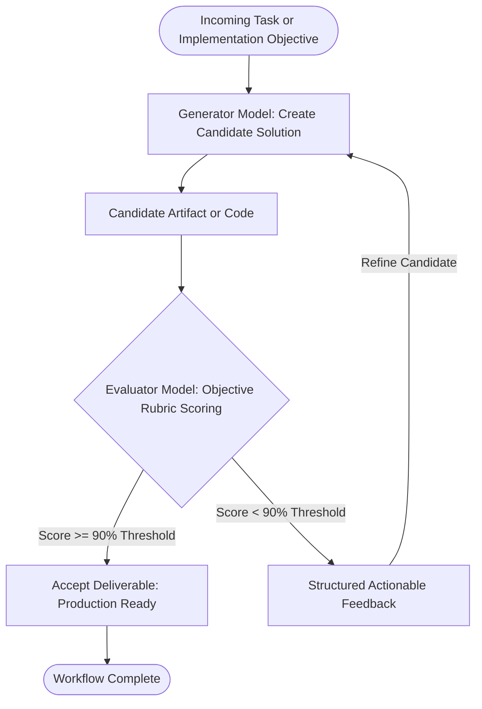

# Directive: Evaluator Optimizer Loop Workflow

## 1. Executive Summary
The Evaluator Optimizer Loop is an iterative refinement architecture where one LLM generates candidate solutions while a distinct Evaluator model critiques the output against an objective scoring rubric. When operating in a single pass, LLMs often miss nuanced edge cases, introduce subtle security regressions, or overlook boundary conditions. By separating generation from evaluation, the system autonomously improves its output quality until an uncompromising threshold is reached.



---

## 2. When to Use This Workflow
* Writing mission critical software components, authentication logic, or payment processing pipelines.
* Authoring complex system architecture plans or high ticket client proposals.
* Reviewing pull request diffs for security vulnerabilities, memory leaks, and performance regressions.
* Generating comprehensive test suites where missing an edge case could compromise system stability.

---

## 3. The Objective Evaluation Rubric
The Evaluator model evaluates candidate solutions across five discrete dimensions, scoring each out of 20 points for a maximum total of 100 points:

| Dimension | Weight | Evaluation Criteria |
| :--- | :--- | :--- |
| Security & Safety | 20 pts | Zero SQL injection, zero XSS, zero secret leaks, safe deserialization, and strict input validation. |
| Functional Correctness | 20 pts | Satisfies 100% of specification requirements, handles boundary inputs, and avoids logic flaws. |
| Performance & Scalability | 20 pts | Avoids O(n²) or worse loops, avoids redundant network/database calls, and respects memory limits. |
| Robustness & Error Handling | 20 pts | Explicit try catch blocks, graceful degradation, typed exceptions, and clean error recovery paths. |
| Maintainability & Cleanliness | 20 pts | Follows DRY principles, clean variable and function naming, explicit typing, and zero dead code. |

---

## 4. Operational Loop Rules

### Rule 1: Persona and Perspective Isolation
The Evaluator must adopt an adversarial persona. It must assume the code contains hidden flaws and actively probe for vulnerabilities, race conditions, and undocumented assumptions. Never allow the Generator to evaluate its own output in the same conversational turn.

### Rule 2: Actionable Feedback Contract
When the Evaluator rejects a candidate (Score < 90%), it must never return vague critiques such as "improve error handling". It must provide concrete feedback containing:
* The exact file path and line number of the deficiency.
* The specific failure mode or security vulnerability demonstrated.
* A concrete code snippet or structural adjustment that resolves the issue.

### Rule 3: Bounded Iteration Limit (Max 3 Loops)
To prevent infinite token loops and diminishing returns:
* Maximum iterations are strictly capped at 3 loops.
* If a candidate fails to achieve the 90% threshold after 3 iterations, execution halts immediately.
* The system escalates the detailed evaluation log and remaining blockers to the human engineer for review.

---

## 5. Output Format of the Evaluator
Every evaluation must produce a standardized assessment block:

```markdown
### Evaluation Summary
* Total Score: [Score] / 100
* Verdict: [PASS / REVISE]

### Critical Issues (Must Fix Before Acceptance)
* [file:line]: Description of critical vulnerability or bug.

### Warnings and Improvements
* [file:line]: Suggested optimization or maintainability refinement.
```
