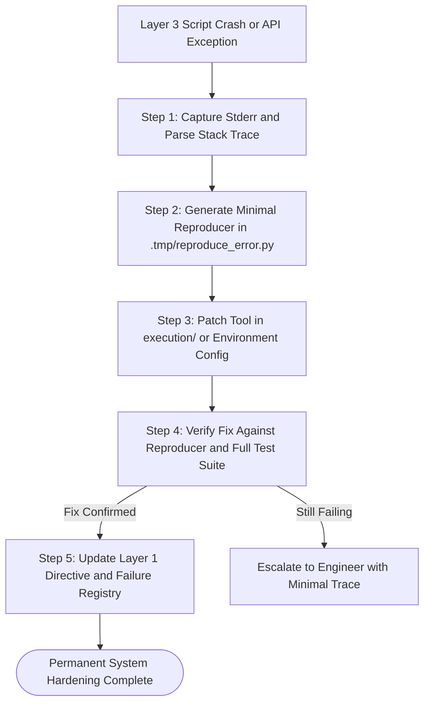

# Directive: Self Annealing Failure Recovery Workflow

## 1. Executive Summary
The Self Annealing Failure Recovery Workflow ensures that every system failure, script crash, or API error is converted into permanent architectural immunity. In traditional development, errors are patched ad hoc and frequently recur. Under self annealing governance, when an execution failure occurs, the agent captures the exact failure vector, builds a minimal reproducer test, patches the underlying tool, verifies the fix, and updates the permanent directive so the failure mode can never happen again.

---

## 2. Core Philosophy: The Zero Amnesia Mandate
Autonomous agents suffer from amnesia across sessions unless system learning is explicitly written to disk. The self annealing loop mandates that:
1. Every bug fix must leave behind two permanent artifacts:
   * A regression test asserting the corrected behavior.
   * An updated Directive or Failure Registry entry explaining the root cause and solution.
2. An error encountered once must never be encountered twice. The system hardens monotonically.

---

## 3. Step by Step Runbook

### Step 1: Capture and Isolate the Failure Vector
* Capture the full execution output, including standard error (stderr), stack traces, exit codes, and input parameters.
* Avoid guessing or speculative patching. Inspect the exact line number where the exception originated.
* Identify whether the failure is environmental (missing dependency, expired token), structural (syntax error, broken import), or runtime (rate limit, malformed payload).

### Step 2: Construct a Minimal Reproducer Script
* Author a standalone, minimal script in `.tmp/reproduce_error.py` that reproduces the exact error in isolation without requiring the full pipeline.
* Confirm that running `python3 .tmp/reproduce_error.py` triggers the identical exception seen in production.

### Step 3: Implement the Deterministic Fix
* Apply the minimal necessary patch to the Layer 3 script in `execution/` or adjust configuration in `.env`.
* If an external API rate limit caused the failure, implement exponential backoff with jitter or batch requests appropriately.
* If a data parsing error occurred, add strict schema validation and null safety checks.

### Step 4: Verify the Resolution
* Run the minimal reproducer script `.tmp/reproduce_error.py` to confirm that the error is completely eliminated.
* Run the broader project test suite (`pytest` or `unittest`) to ensure no collateral regressions were introduced.
* Purge the temporary reproducer file from `.tmp/`.

### Step 5: Update the Living Directive and Failure Registry
* Open the relevant SOP in `directives/` or the Master Operating Directive.
* Add an explicit entry under the Self Annealing Failure Registry detailing:
  * Failure description and symptom.
  * Root cause identified.
  * Permanent architectural solution implemented.

---

## 4. Anti Patterns and Banned Behaviors
* Silent Exception Swallowing: Wrapping failing blocks in blanket `except Exception: pass` without logging or remediation is strictly banned.
* Speculative Retries: Looping the same failing command repeatedly without modifying the code or environment burns tokens and risks API bans.
* Unrecorded Fixes: Applying a fix in memory without committing the changes to the execution script and directive guarantees the bug will recur in future sessions.
