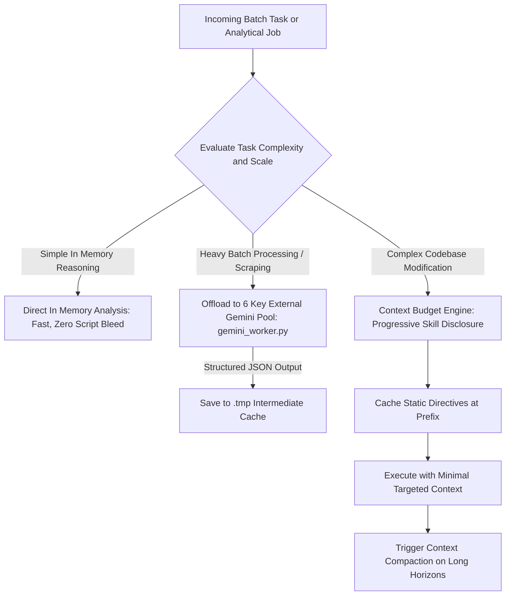

# Directive: Context Engineering and Token Economy Management

## 1. Executive Summary
Context Engineering has superseded prompt engineering as the definitive discipline of modern AI systems development. The context window is not an infinite dumping ground; it is a finite, high cost operational budget. Degradation of reasoning quality occurs when context windows become saturated with unneeded file dumps, noisy stack traces, and verbose conversations. This workflow establishes strict protocols for prompt caching, progressive disclosure, context compaction, and external API pool offloading.

---

## 2. Core Pillars of Context Engineering

### Pillar 1: Prompt Caching Architecture
Modern LLM APIs leverage prefix caching to reduce latency and token costs by up to 90%:
* Structure system prompts with all static content first (governance rules, role definitions, standard tool schemas).
* Place dynamic session content (user requests, active files, current date time) strictly at the end of the prompt.
* Avoid mutating system prompts or swapping directive order mid session, which invalidates the cached prefix.

### Pillar 2: Progressive Disclosure
Never load entire repositories or voluminous instruction manuals into the base prompt:
* Skills are loaded progressively: only their names and brief one line descriptions are injected at session start.
* The full content of a skill (`SKILL.md`) is loaded into context only when the agent or user explicitly activates that capability.
* Keep `CLAUDE.md`, `AGENTS.md`, and `GEMINI.md` lean, modular, and focused on core operational invariants.

### Pillar 3: Context Compaction and Transcript Hygiene
* For extended sessions exceeding 20 conversation turns, trigger context compaction (`/compact`) to summarize completed milestones.
* Ephemeral data, long terminal outputs, and raw HTML scrapings must never linger in memory; write them to `.tmp/` and reference them by file path rather than printing raw text into the conversation.

---

## 3. External API Offloading (The 6 Key Gemini Pool)
To preserve the primary agent context budget and avoid quota burnout during heavy data operations:
* Batch text evaluations, lead scraping audits, and bulk JSON filtering must be offloaded to the external 6 key Gemini rotating worker pool (`gemini_worker.py`).
* This offloading consumes zero primary Antigravity workspace tokens.
* Model Calibration: Always target `gemini-flash-lite-latest` for high volume worker pools. The standard flash alias (`gemini-flash-latest`, targeting 3.8 flash) carries a tight 20 request daily limit on free tier, whereas flash lite provides high throughput without quota exhaustion.

---

## 4. Token Preservation and Anti Script Spam
* In Memory Analytical Standard: Simple calculations, JSON inspections, and basic reading tasks must execute in memory within seconds.
* Anti Script Spam Mandate: Never launch exploratory Python scripts or multi command shell loops for basic text reading. Reserve script generation strictly for persistent state changes or complex pipeline executions.
* Structured Output Compaction: Require all execution tools to emit compact, machine readable JSON summaries rather than verbose human conversational text.
