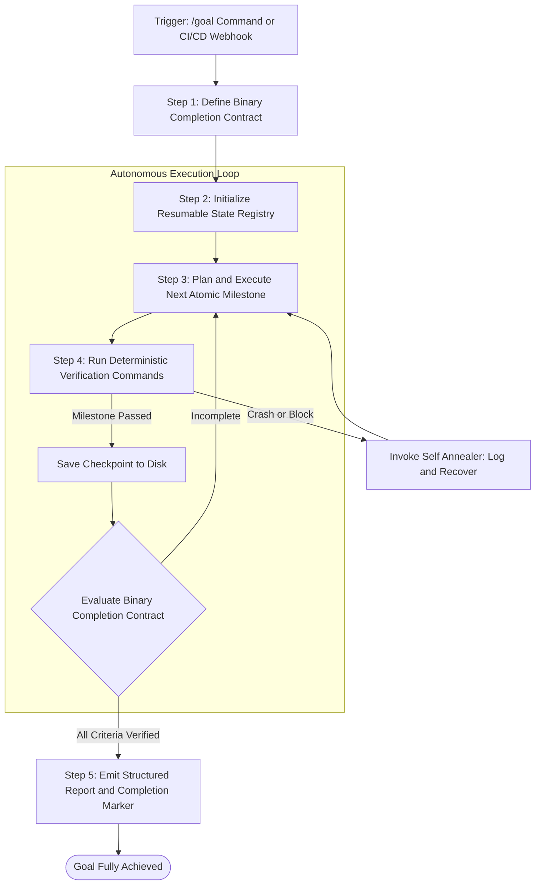

# Directive: Headless Autonomous Goal and CI Runner Workflow

## 1. Executive Summary
The Headless Autonomous Goal and CI Runner Workflow governs non interactive, high duration agent execution across autonomous loops (such as the Antigravity `/goal` slash command) and continuous integration pipelines (such as `claude -p` headless execution and GitHub Actions). When operating without a human in the loop, the agent must enforce strict completion contracts, automated checkpointing, bounded turn limits, and deterministic output verification.

---

## 2. Core Governance for Long Running Autonomous Execution

### The Binary Completion Contract
Before beginning autonomous execution, the agent must define a clear, non negotiable checklist of observable deliverables:
* What specific files must be created or modified?
* What specific test commands must return exit code 0?
* What structural or schema validation tests must pass?
The agent is strictly prohibited from terminating or declaring completion until every single criterion is proven with empirical command logs.

### Resumable State and Idempotency
Because long running processes can encounter network interruptions, machine restarts, or token refresh events:
* All execution state must be persisted incrementally to a local status registry (e.g. `.tmp/goal_state.json`).
* Tasks must be idempotent: rerunning a partially completed milestone must not duplicate actions, double post data, or corrupt files.

---

## 3. Headless CLI Integration Patterns (Print Mode and AGY)
When executing from scripts, daemons, or CI pipelines:

### 1. One Shot Headless Execution via Print Mode
* Invoke single shot commands with explicit prompts:
  `claude -p "Audit this repository for security vulnerabilities and emit a JSON report" --output-format json`
* Bypass interactive prompts by pre approving required deterministic tools:
  `--allowedTools Read,Edit,Bash`
* Enforce maximum turn limits to prevent runaway loops:
  `--max-turns 30`

### 2. CI/CD Automated Pull Request Review
* Run automated reviews on git diffs:
  * Extract PR diff using `git diff origin/main...HEAD`.
  * Pass diff to the review harness.
  * Check for SQL injection, exposed API keys, O(n²) bottlenecks, and missing unit tests.
  * Fail CI build if critical severity issues are discovered.

---

## 4. Completion Verification and Audit Protocol
Upon completing all tasks in an autonomous goal run:
1. Run Full Regression Suite: Execute the entire project test runner to verify that zero regressions exist.
2. Verify File System Integrity: Check that all target artifacts exist, contain valid contents, and are referenced in master documentation.
3. Emit Final Completion Marker: The agent produces the standard completion marker (e.g. `<!-- GOAL_COMPLETE -->`) only when completely confident in the deliverables.
