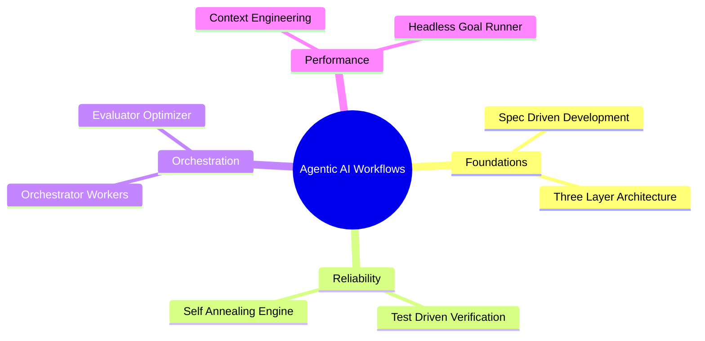

# Master Agentic AI Workflows Suite

## 1. Executive Overview
This directory houses the definitive suite of Agentic AI workflows, skills, and execution runbooks designed for elite AI systems engineering. Synthesized from canonical frameworks by Anthropic, developer workflows from Boris Cherny (creator of Claude Code), the Everything Claude Code ecosystem, and Google Antigravity 2.0, this architecture establishes the gold standard for reliable, context aware, and self annealing agent operations.

Every workflow adheres strictly to the Three Layer Architecture (Directive, Orchestration, Execution), eliminating probabilistic hallucinations by anchoring business logic to deterministic code.

---

## 2. Master Workflow Routing Matrix

| # | Workflow Name | Primary Purpose | Layer 1 SOP Reference | Trigger Slash Command |
| :--- | :--- | :--- | :--- | :--- |
| 1 | Spec Driven Development | Replaces vibe coding with PRD specifications, blueprints, and task matrices | `directives/workflows/01_spec_driven_development.md` | `/spec <feature>` |
| 2 | Three Layer Architecture | Decouples intent from deterministic execution tools to eliminate probabilistic creep | `directives/workflows/02_doe_three_layer_architecture.md` | Built in DOE Standard |
| 3 | Test Driven Verification | Enforces 80% plus test coverage, Red Green Refactor cycles, and verifiable proof | `directives/workflows/03_tdd_and_verification_engine.md` | `/tdd <plan>` |
| 4 | Orchestrator Workers | Dynamic task decomposition with parallel context isolated subagents | `directives/workflows/04_orchestrator_workers_pattern.md` | Native Multi Agent |
| 5 | Evaluator Optimizer | Dual loop generation and adversarial critique with objective 100 point rubric | `directives/workflows/05_evaluator_optimizer_loop.md` | `/review` |
| 6 | Self Annealing Engine | Converts execution crashes and API errors into permanent system immunity | `directives/workflows/06_self_annealing_failure_recovery.md` | `/anneal` |
| 7 | Context Engineering | Optimizes prompt caching, progressive disclosure, and token budgeting | `directives/workflows/07_context_engineering_and_token_economy.md` | In Memory / Worker Pool |
| 8 | Headless Goal Runner | Bounded autonomous execution for long running goals and CI/CD pipelines | `directives/workflows/08_headless_goal_and_ci_runner.md` | `/goal <objective>` |
| 9 | MAK High Velocity Copilot | Stealth execution engine for daily 2 hour client shifts with automated evidence logs | `directives/workflows/mak_copilot_protocol.md` | `/mak <task>` |

---

## 3. Detailed Workflow Runbooks

### Workflow 1: Spec Driven Development (SDD)
* Philosophy: The specification is the permanent source of truth. Implementation code is never authored until business intent, architectural topology, and acceptance tests are formally agreed upon.
* Runbook:
  1. Author the feature specification under `docs/specs/<feature>.spec.md`.
  2. Conduct adversarial inquiry to probe boundary conditions, edge cases, and hidden assumptions.
  3. Author the architectural blueprint under `docs/plans/<feature>.plan.md`.
  4. Decompose the plan into atomic checklist tasks under `docs/tasks/<feature>.tasks.md`.
  5. Execute implementation strictly against the acceptance criteria.

### Workflow 2: Three Layer Architecture (DOE)
* Philosophy: LLMs are probabilistic, whereas business operations demand consistency. Complexity is pushed into deterministic code.
* Runbook:
  1. Layer 1 (Directive): Standard Operating Procedures stored in `directives/` define goals, inputs, deterministic scripts, and edge cases.
  2. Layer 2 (Orchestration): The reasoning agent inspects directives, routes tasks, and handles exceptions.
  3. Layer 3 (Execution): Deterministic Python scripts in `execution/` make API calls, mutate databases, and transform data.

### Workflow 3: Test Driven Verification Engine
* Philosophy: No code is accepted without proof. Red phase proves the test is capable of detecting failure; Green phase proves the fix works; Refactor phase optimizes structure.
* Runbook:
  1. Automatically resolve the workspace test runner (pytest, unittest, vitest, bun test).
  2. RED Phase: Author test asserting requirement. Run runner and confirm failure.
  3. GREEN Phase: Write minimal implementation to satisfy assertion with exit code 0.
  4. REFACTOR Phase: Clean and modularize without breaking green status.
  5. Commit with verifiable evidence.

### Workflow 4: Orchestrator Workers Multi Agent Pattern
* Philosophy: Avoid the 15x token explosion by dispatching subagents exclusively for read heavy parallel tasks while keeping write heavy code generation single threaded.
* Runbook:
  1. Central Orchestrator dynamically plans required specialist roles.
  2. Dispatches worker subagents in isolated context windows (Security Expert, Performance Analyst, Style Reviewer).
  3. Workers return concise, structured findings without conversational fluff.
  4. Central Orchestrator synthesizes findings and resolves conflicting recommendations.

### Workflow 5: Evaluator Optimizer Loop
* Philosophy: Single pass LLM generation misses nuanced edge cases. Separating the Generator from an adversarial Evaluator produces elite output quality.
* Runbook:
  1. Generator model authors candidate artifact.
  2. Evaluator model conducts adversarial scoring across 5 dimensions: Security (20 pts), Correctness (20 pts), Performance (20 pts), Robustness (20 pts), Maintainability (20 pts).
  3. If Total Score is below 90 points, Evaluator returns precise file and line feedback.
  4. Generator refines candidate. Loop repeats up to a maximum of 3 iterations.

### Workflow 6: Self Annealing Failure Recovery
* Philosophy: Zero amnesia. A bug encountered once must never recur.
* Runbook:
  1. Capture standard error, stack trace, and failing input parameters.
  2. Author minimal standalone reproduction script in `.tmp/reproduce_error.py`.
  3. Implement deterministic patch in `execution/` script or configuration.
  4. Verify fix against reproducer and full regression test suite.
  5. Update the relevant SOP in `directives/` and record the resolution in the Failure Registry.

### Workflow 7: Context Engineering and Token Economy
* Philosophy: Context is an operational budget. Treat it with maximum discipline.
* Runbook:
  1. Maintain static prompt rules at the prefix to leverage 90% prompt caching discounts.
  2. Use progressive disclosure: keep base system prompts lean and load `SKILL.md` files only on demand.
  3. Offload heavy batch processing and bulk evaluations to the external 6 key Gemini rotating worker pool (`gemini_worker.py`).
  4. Calibrate worker models to `gemini-flash-lite-latest` to avoid free tier quota burnout.

### Workflow 8: Headless Goal and CI Runner
* Philosophy: Long running goals require binary completion contracts and resumable state to succeed without human intervention.
* Runbook:
  1. Formulate binary completion contract upfront: observable files created and test commands that must return exit code 0.
  2. Initialize resumable state registry in `.tmp/goal_state.json`.
  3. Execute milestones sequentially with automated checkpointing.
  4. In headless CI mode (`claude -p`), enforce `--allowedTools` and `--max-turns` limits.
  5. Emit completion marker only after empirical verification of all contract deliverables.

---

## 4. Skills Inventory (`.agents/skills/`)
These portable skills follow the open Agent Skills standard (`agentskills.io`), natively discoverable by both Antigravity 2.0 and Claude Code:

* `spec_driven_dev`: Full PRD, technical blueprint, and task decomposition engine.
* `tdd_engine`: Red Green Refactor test driver with coverage enforcement.
* `evaluator_critic`: Adversarial security, performance, and correctness auditor.
* `self_annealer`: Failure diagnostic, reproducer generator, and directive updater.
* `context_optimizer`: Token preservation, context compaction, and worker pool router.
* `shadow_harness`: Cognitive auditing harness for end of day reviews and post execution inspections.

---

## 5. Slash Commands Directory

| Command | File Path | Scope | Purpose |
| :--- | :--- | :--- | :--- |
| `/spec <feature>` | `.claude/commands/spec.md` & `.agents/workflows/spec.md` | Workspace | Launches Spec Driven Development cycle |
| `/tdd <plan>` | `.claude/commands/tdd.md` & `.agents/workflows/tdd.md` | Workspace | Launches Test Driven Development engine |
| `/review` | `.claude/commands/review.md` & `.agents/workflows/review.md` | Workspace | Launches Evaluator Critic code review |
| `/anneal` | `.claude/commands/anneal.md` & `.agents/workflows/anneal.md` | Workspace | Launches Self Annealing failure recovery |
| `/goal <target>` | `.claude/commands/goal.md` & `.agents/workflows/goal.md` | Workspace | Launches autonomous goal pursuit with binary contract |
